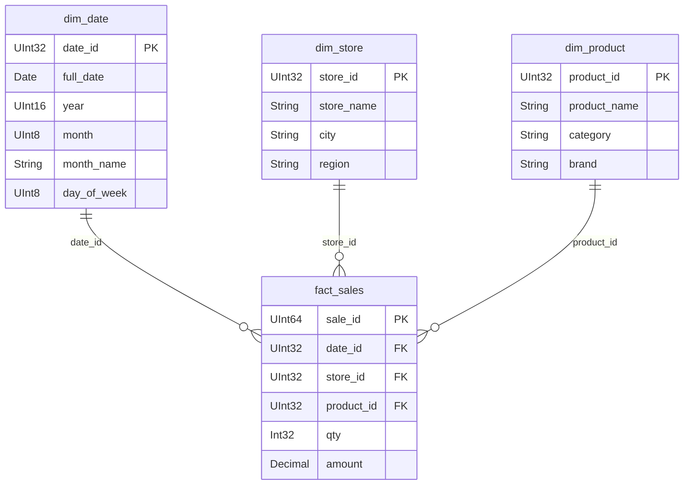

# Star Schema — D1 «Розница»

**Зерно:** одна строка `fact_sales` — одна позиция продажи товара в конкретном магазине на конкретную дату (`sale_id` — идентификатор строки, не номер чека).

**Главная метрика:** `SUM(fact_sales.amount)` — общая выручка.

**Примечание:** `PK`/`FK` на схеме — логические ключи аналитической модели. Исходный ClickHouse DDL задаёт `MergeTree ORDER BY`, не SQL-ограничения первичного/внешнего ключа. Схема соответствует четырём таблицам `init/01_schema.sql` учебного стенда.
